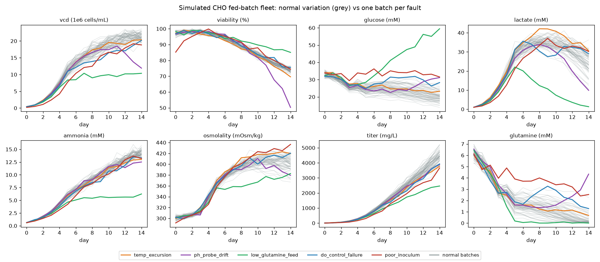
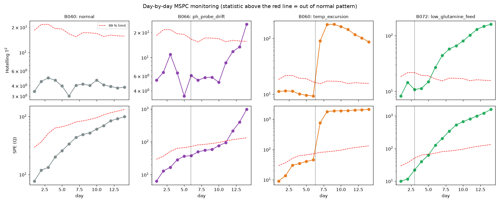
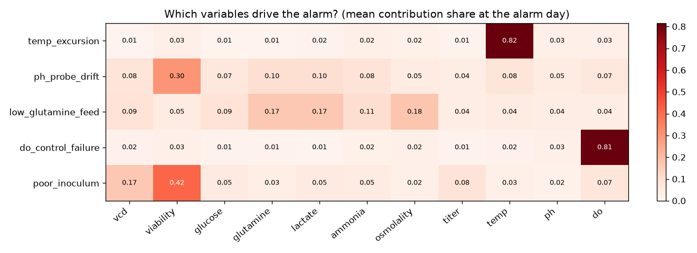
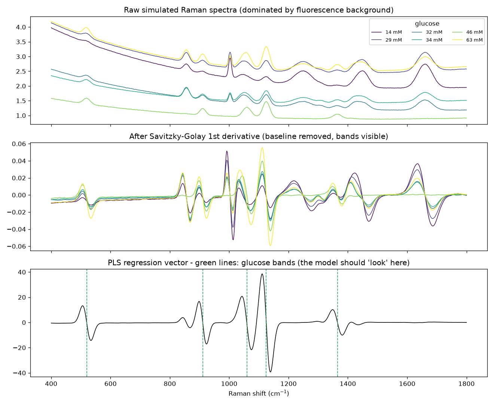
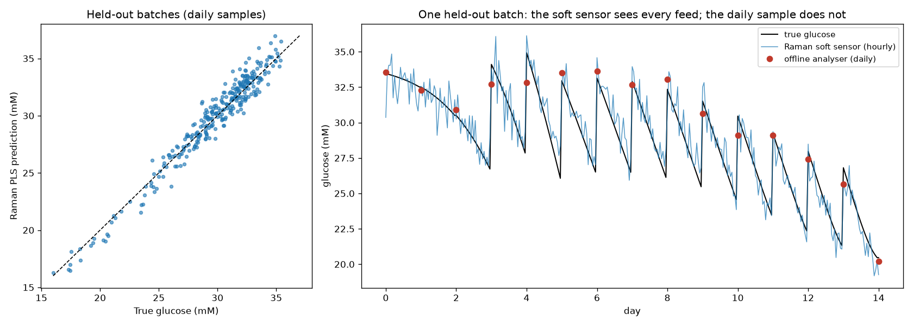
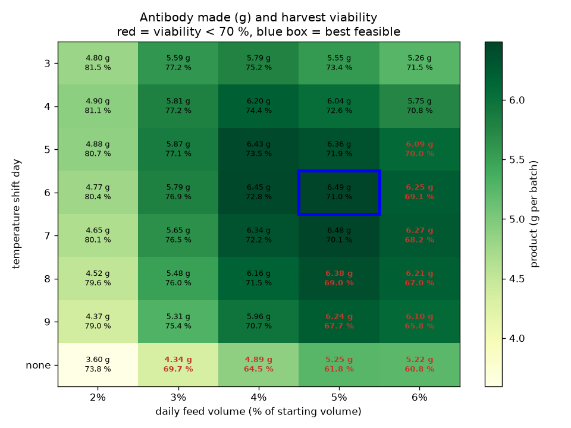

# Bioprocess Digital Twin

**A mechanistic digital twin of a CHO-cell fed-batch bioreactor (the workhorse of monoclonal-antibody manufacturing), with multivariate statistical process monitoring, a Raman spectroscopy soft sensor and in-silico process optimisation, in Python.**

Biologics plants run 14-day cell-culture batches that are worth a lot of money each. Three questions come up every day:

| Module | Question it answers | Methods |
|---|---|---|
| `model.py` | *How will this batch behave?* | ODE model: Monod growth kinetics, lactate/ammonia inhibition, lactate metabolic shift, osmolality, temperature/pH/DO effects, Luedeking–Piret production, bolus feeding |
| `batches.py`, `mspc.py` | *Is this batch going wrong, and why?* | Simulated fleet with run-to-run variation and 5 fault types; batch-wise unfolded **PCA** with **Hotelling's T²** and **SPE** limits (Nomikos–MacGregor), leave-one-out control limits, day-by-day evolving models, **contribution analysis** |
| `softsensor.py` | *What is glucose doing between daily samples?* | Simulated in-line **Raman** spectra, Savitzky–Golay / SNV preprocessing, **PLS regression**, batch-grouped cross-validation, spiked calibration |
| `optimize.py` | *What recipe should we run?* | Scan of temperature-shift day × feed rate with a harvest-viability constraint (a "design space") |

> **All data here is simulated.** Kinetic parameters are illustrative, chosen to give textbook-looking CHO profiles. They are not fitted to a real cell line, and the Raman band positions are approximate. The point is the *methods*, which are the ones used in industrial process analytics (PAT / continued process verification).

## Results

`python -m biotwin` (seed 3, about 25 s) gives:

### 1. The twin: a 90-batch fleet with realistic variation and faults

The nominal recipe (inoculate at 0.4×10⁶ cells/mL, daily bolus feeds from day 3, temperature shift 37 → 33 °C on day 5) gives peak VCD ≈ 21×10⁶ cells/mL, harvest viability ≈ 74 %, titer ≈ 4.5 g/L and osmolality ≈ 400 mOsm/kg. It also reproduces the lactate shift: cells produce lactate while growing fast and consume it once growth slows.



| Fault (6 batches each) | What happens |
|---|---|
| `temp_excursion` | jacket/heater fault, +2 °C for 2 days |
| `ph_probe_drift` | the pH probe drifts, so the controller holds the *real* pH lower while the probe still reads 7.0 |
| `low_glutamine_feed` | wrong feed lot, glutamine at 25 % of spec |
| `do_control_failure` | sparger fouling, dissolved O₂ at 3 % for 3 days |
| `poor_inoculum` | seed-train problem: half the cells, 85 % viability |

### 2. MSPC: every fault caught, and why the control limits matter

A PCA model per day is trained on 40 normal batches only (11 variables × days so far). It is then tested on 20 *new* normal batches and 30 faulty ones. An alarm needs 2 consecutive days outside the 99 % limits.

| Fault | Detected | Mean days from fault start to alarm | Top variables in contribution plot |
|---|---|---|---|
| temp_excursion | 6/6 | 1.7 | **temp** |
| do_control_failure | 6/6 | 1.6 | **do** |
| poor_inoculum | 6/6 | 2.0* | **viability**, vcd |
| low_glutamine_feed | 6/6 | 3.3 | osmolality, **glutamine**, lactate |
| ph_probe_drift | 6/6 | 6.4 | viability, glutamine, lactate |

\* 2 days is the earliest possible with the two-day rule.





Two findings:
- **Control limits estimated from the training batches' own statistics are useless on new batches.** They raised alarms on **20/20** new *normal* batches, because PCA partly fits the noise of the batches it was trained on. Limits from **leave-one-out** statistics (each training batch scored by a model that never saw it) bring this down to 2/20, with a 3.6 % per-day out-of-limit rate.
- **The pH-probe fault is the slowest to catch (6.4 days)** because the probe keeps reading 7.0; the controller is fooled. MSPC still finds it through the cells' response (viability, lactate, glutamine). The contribution plot points at biology rather than the pH signal, which is itself a clue to suspect the sensor.

### 3. Raman soft sensor: hourly glucose to ±0.9 mM



| Preprocessing | PLS components | RMSECV (mM) |
|---|---|---|
| raw | 5 | 1.58 |
| **Savitzky–Golay 1st derivative** (selected) | **2** | 1.63 |
| SG derivative + SNV | 5 | 3.99 |

The derivative model is selected as the simplest within 5 % of the best. SNV *hurts* here because each spectrum's overall intensity is dominated by fluorescence, which grows with biomass, so normalising by it injects a biomass-dependent error. The bottom panel shows the PLS regression vector peaking at the glucose bands, so the model is reading glucose rather than a proxy.

On 20 held-out batches: **RMSEP 0.89 mM vs true glucose (R² 0.94)**, or 1.29 mM vs the offline analyser. The analyser's own ±3 % error sets that floor, so a model can never look better than its reference method.



**Spiked calibration samples matter when it counts.** On the faulty batches, where glucose climbs above the normal range (> 40 mM), error falls from 2.45 to 1.69 mM when the calibration includes glucose-spiked samples.

### 4. Using the twin to choose a recipe



More feed means more nutrients but also more osmotic stress, and shifting the temperature trades growth for productivity. Keeping harvest viability ≥ 70 % (a downstream-processing constraint), the best setting (shift on day 6, 5 % feed/day, 6.49 g) is less than 1 % better than the nominal recipe (6.43 g). The nominal recipe sits on a broad, robust plateau, which is exactly what you want a design space to show.

## Quick start

```bash
python -m venv .venv
.venv\Scripts\activate          # Windows  (macOS/Linux: source .venv/bin/activate)
pip install -e ".[dev]"
pytest                          # 22 tests, ~25 s
python -m biotwin               # full run -> reports/figures/*.png + reports/metrics.json
python -m biotwin --quick       # smaller fleet
```

```python
from biotwin.model import Recipe, simulate_batch
result = simulate_batch(Recipe(temp_shift_d=4, feed_frac=0.05))
print(result.samples[["time_d", "Xv", "viability", "GLC", "LAC", "P"]])
```

## Project layout

```
biotwin/
  model.py       ODE model of the bioreactor + fed-batch simulation
  batches.py     fleet generator: run-to-run variation, 5 fault types, analyser noise
  mspc.py        batch-wise unfolding, PCA with T2/SPE limits, evolving monitor, contributions
  softsensor.py  Raman simulation, preprocessing, PLS calibration with grouped CV
  optimize.py    recipe scan with viability constraint
  pipeline.py    runs everything and writes reports/
tests/           22 pytest tests (mass balance, physiology, statistics, end-to-end)
docs/WALKTHROUGH.md   plain-English explanation of the biology, statistics and design choices
```

## References

- Nomikos & MacGregor (1995). *Multivariate SPC charts for monitoring batch processes.* Technometrics 37(1).
- Xing et al. (2010). *Modeling kinetics of a large-scale fed-batch CHO cell culture by Markov chain Monte Carlo method.* Biotechnology Progress 26(1).
- ICH Q8(R2) *Pharmaceutical Development* (Quality by Design, design space) and FDA (2004) *PAT Guidance for Industry*.

## License

MIT
